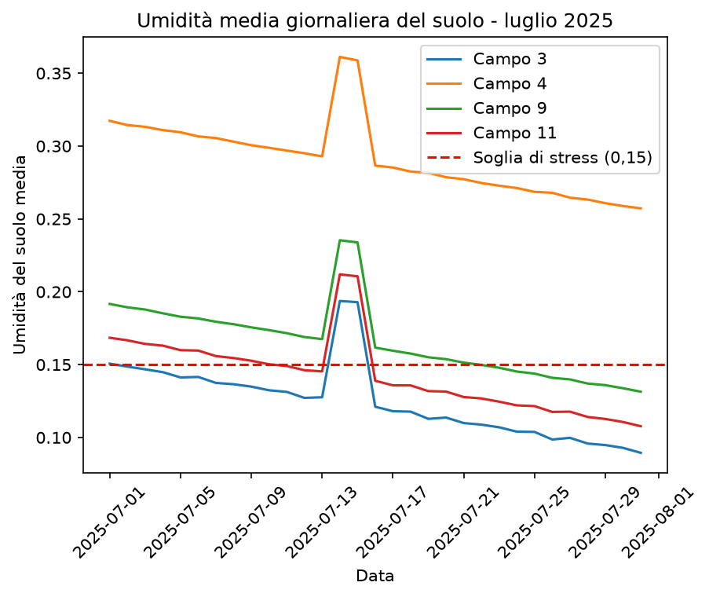

# Monitoraggio dell'umidità del suolo da sensori IoT

## In breve
Analisi dell'umidità del suolo a luglio 2025 rilevata tramite sensori in 20 campi di diverse colture nel nord Sardegna con dati simulati. L'obiettivo del progetto è quello di:
- Selezionare solo i campi con dati affidabili per l'analisi
- Individuare possibili problemi di calibrazione dei sensori
- Valutare la presenza di stress idrico nelle colture al fine di determinare quelle maggiormente colpite in ciascun comune
- Verificare quali campi soddisfano i requisiti di almeno 10 giorni consecutivi di stress idrico per l'accesso al contributo per l'irrigazione. 

L'analisi è stata effettuata solo sui campi con almeno 2 sensori attivi a luglio (17 su 20 iniziali) e ha rilevato possibili problemi di calibrazione dei sensori in 4 campi (11, 19, 5 e 3). Dai dati emerge che le colture con maggiore stress idrico sono la vite per il comune di Alghero, il carciofo per Porto Torres e il grano duro per Sassari. Dei 17 campi analizzati solo 10 hanno diritto al contributo per l'irrigazione.

## Dati
Sono fornite 3 tabelle, tutte con dati simulati:
- campi.csv: id_campo | comune | coltura | superficie_ha
- letture.csv: una lettura ogni 15 minuti per sensore, 156.480 righe, id_sensore | data_ora | umidita_suolo
- sensori.csv: id_sensore | id_campo | data_installazione

## Workflow
1. **Caricare e ispezionare le tabelle**: sono stati rilevati 795 valori mancanti di umidità del suolo nella tabella letture, esclusi automaticamente dal calcolo delle medie.
2. **Qualità dei dati**: 115.200 letture effettuate dai sensori a luglio 2025, 17 campi con almeno 2 sensori attivi a luglio 2025 corrispondenti a 106.272 letture, 3 campi esclusi (campo 6 con un solo sensore, 13 con 2 sensori di cui uno installato solo ad agosto 2025 e 16 con un sensore non funzionante).
3. **Stress idrico per coltura**: calcolata la media dei giorni di stress per ogni comune e coltura considerando come giorni di stress quelli con umidità media < 0,15 e identificata la coltura più stressata per ogni comune (vite per Alghero, carciofo per Porto Torres e grano duro per Sassari).
4. **Sensori in disaccordo**: identificati 4 campi con possibili problemi di calibrazione dei sensori confrontando le letture dei sensori dello stesso campo.
5. **Stress prolungato e contributo**: trovate tutte le serie di giorni di stress consecutivi, identificata la serie più lunga per ogni campo e individuati 10 campi su 17 con diritto al contributo per l'irrigazione.
6. **Andamento dell'umidità**: andamento dell'umidità del suolo nel tempo per 4 campi su 17, individuata una possibile pioggia il 14 e 15 luglio 2025.

## Risultati
- 17 campi su 20 rispettavano i requisiti di affidabilità (almeno 2 sensori attivi a luglio 2025)
- 4 campi (11, 19, 5 e 3) con possibili problemi di calibrazione dei sensori
- Le colture più stressate per comune sono la vite per Alghero, il carciofo per Porto Torres e il grano duro per Sassari
- 10 campi su 17 analizzati hanno diritto al contributo per l'irrigazione (1, 2, 3, 5, 7, 9, 10, 11, 15 e 18).

## Conclusioni
- **Numero di sensori per campo**: dei 20 campi iniziali 3 sono stati esclusi perché non rispettavano il requisito di almeno 2 sensori attivi a luglio 2025. In particolare per il campo 6 sarebbe consigliabile installare almeno un altro sensore, mentre per il 16 è necessario verificare il funzionamento del sensore 131, dato che la sua ultima lettura risale al 27 giugno 2025.
- **Calibrazione dei sensori**: il calcolo del disaccordo dei sensori mostra la necessità di una verifica dei sensori nei campi 11, 19, 5 e 3 a causa di possibili problemi di calibrazione.
- **Colture in maggiore stress idrico**: è consigliata un'attenzione particolare all'irrigazione delle colture di vite nel comune di Alghero, carciofo a Porto Torres e grano duro a Sassari, poiché risultano essere quelle con maggiore stress idrico.
- **Contributo per l'irrigazione**: solo i campi 1, 2, 3, 5, 7, 9, 10, 11, 15 e 18 presentano una serie di almeno 10 giorni consecutivi di stress idrico e hanno dunque diritto al contributo per l'irrigazione.

## Limiti
- **I dati utilizzati sono simulati**: i risultati ottenuti non descrivono una situazione reale; l'obiettivo è mostrare il metodo di analisi.
- **Pioggia non verificata**: l'incremento di umidità del suolo osservato il 14 e il 15 luglio 2025 è stato spiegato come una possibile conseguenza di una pioggia, ma il dato non è stato verificato con dati meteorologici.
- **Soglia di stress idrico**: la soglia di 0,15 usata come riferimento per lo stress idrico è un valore generico che può variare a seconda di fattori quali coltura e tipologia di suolo.
- **Disaccordo tra sensori**: il calcolo del disaccordo permette di rilevare la presenza di differenze tra le letture dei vari sensori, ma non indica quali siano i sensori mal calibrati.

## Strumenti
Python · pandas · matplotlib · Jupyter